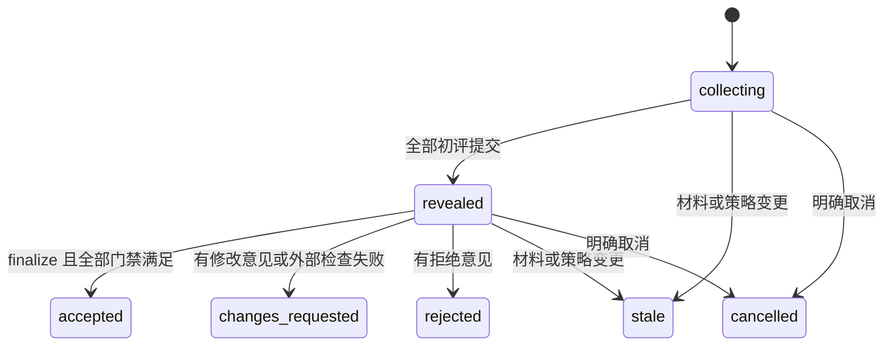

# 正式评审、证据快照与外部检查

当前实现与验收只以[进度](progress.md)和[审查索引](reviews/README.md)为准；以下阶段事实保留当时范围，不作为后续dispatch或宿主认证升级。

## M7.1-B1历史接入事实（2026-10-10）

历史事实：M7.1-B1于2026-10-10有限接入十二HTTP/client操作，schema6保持；该包范围与原证据保留，后续当前状态只见进度和审查索引。

公开 run/receipt/snapshot/固定 post revision/required checks 使用白名单 DTO 和整对象绑定 guard；run 不公开持久审计字段 created_request_version。required checks 仅冻结名单中最新 run（最多32），缺 run 显式 null，无全 attempt 目录。snapshot 复用唯一 canonical JCS 实现，客户端对 UTF8 实际 WebCrypto SHA 校验 manifest_sha256。

普通 create/invalidate 支持既有显式或持久 logicalOperationId key；verify receipt/log 只支持显式或每调用 key，在读取文件、HTTP/getMe 前拒 logicalOperationId，不做普通身份发现。issuer 无 key、retryBudget0、一次明文；按当前空间 owner/maintainer 核心授权。既有 admin 虚拟 owner 仅在无 membership 且 allowed_space_ids 已允许空间时适用，已有低角色或 inactive membership 不被覆盖。

run-bound 附件使用精确编码 scoped URL，客户端只访问构造的同 origin 路径；沿用 bounded/hash/EOF/取消/迟到 body dispose/no-clobber 传输。check 路径包括错误早退均 private, no-store；不放宽 generic artifact、私有评审或 verify 的空间/getMe 权限。run 按因果版本判断，不要求墙钟单调；请求与响应均按 Unicode 码点验证 reason 上限500。


## M7.1-A已实现的内部检查门禁（2026-10-10）

冻结manifest的required_checks按各名称最大attempt读取，没有run或pending/invalidated仍为pending；全部pass才passed，有fail为failed、否则error为error，无required为not_required。管理员/维护者创建run与invalidate；冻结profile允许的活动service verifier actor不要求普通membership，受限verify credential仅能读固定run材料/允许日志及提交自身receipt，不能借同actor普通凭据或管理员身份读sealed意见。

新fresh accepted裁决必须latest required checks全pass且其日志当前ready/可读；负评优先的changes_requested可保receipt_ids=[]，由检查失败导致的changes_requested必须引用因果版本下完整且精确的failed集合，不借旧attempt批准。decision不可变；post-finalize invalidate只影响当前事实，不覆写历史pass。current_validity新增check_invalidated、check_log_redacted、check_log_unavailable原因，严格全原因及顺序保持；当前状态和历史裁决分别解释。redaction/unavailability仍404/410优先，不恢复清除内容。

受限凭据由维护权限内部一次性明文签发，token只存hash，rotation只撤销同run旧绑定，expiry/revoke/actor disable每次生效；不是普通MCP工具。公开check HTTP/client、外部验证器及D01完整链尚未实施。以下旧阶段段落属于其当时合同/证据，不将原pending演示改写成历史passed。

以下为C2A阶段实现记录，当前增量见上文：十三评审HTTP/共享客户端、十三CLI与九工具保持；C2A知识正式状态已有限接受。评审、检查、当前有效性分别投影，不把揭示/接受当检查通过。按用户2026-10-09最新范围，不再开发前端或安排Web、视觉、浏览器专项；现有Web源码与已取得历史证据保留。后续聚焦服务端、HTTP、CLI、MCP及dsh/Pi/Codex/Claude接入、协作、正式评审与外部检查。C2B公开意见检索和M7 checks/receipts、D01完整演示与维护交付仍待，完整目标尚未完成。

## 1. 必须分开的事实

`review_status` 表示评审流程；`verification_status` 表示配置的检查；`current_validity` 表示材料和批准是否仍适用于当前版本。不能折叠成一个无解释的绿色“成功”。

API 中 review_status 映射到 request.phase；verification_status 为 `not_required | pending | passed | failed | error`，全部 required_checks 的有效最新 attempt 通过才为 passed。current_validity 为 `current | challenged | superseded | invalidated`，冲突优先级从后向前，另给 validity_reasons 数组保留全部原因；current 本身不代表评审通过。

研究默认：两名非贡献者、不同 actor、分别封存初评、快照绑定。外部检查名称由项目定义；关闭检查的讨论项目可以通过 review，但 verification 必须显示 `not_required`。使用“研究结论已验收”标签必须同时满足当前项目配置的全部门禁。

## 2. 策略与评审请求

策略位于版本化 space_revision，普通帖子无权修改：

```json
{
  "enabled": true,
  "required_reviewers": 2,
  "exclude_contributors": true,
  "distinct_actors": true,
  "distinct_independence_groups": false,
  "seal_until_all_submitted": true,
  "invalidate_on_revision": true,
  "required_checks": ["reproduce"],
  "allow_open_objections": false
}
```

首版支持 required_reviewers 1–5，默认 2；指定人数即本轮全部评审人数，不实现复杂投票阈值。强研究预设不能关闭贡献者排除、封存初评或修订失效。放宽策略必须创建新规则修订；不得静默使已失败轮次通过。

required_checks 引用同一有效空间策略的 check_profiles。检查配置缺失时可保存空间草案，但正式 review request 必须拒绝并报告 VALIDATION_ERROR；不能静默忽略所需检查。仅改置顶摘要不推进 policy_revision，不无故使研究材料失效。

当前 `POST /api/v1/spaces/:space_id/review-requests` body 输入：target_ref、dependency_refs、artifact_ids、code_refs（repository、精确commit、source_artifact_id、reproduction_instructions）、declared_contributors、reviewer_actor_ids、expected_policy_revision、顶层reproduction_instructions。请求键通过HTTP `Idempotency-Key`，不在body；tool层名为request_key。内部M6.1-B已执行目标作者或当前maintainer/owner的申请门禁；独立材料builder仍仅observer授权，不能将单独构造材料当申请成功。字段限额与错误见[协议当前材料构造](04-protocol.md#m61-a-未公开评审请求与材料构造)。

reviewer 必须是有效成员并被空间 owner 标记 eligible；不能由作者随意创建两个假账号。服务根据被纳入帖子所有修订的作者/编辑者、声明的代码贡献者和显式贡献名单计算排除集，取并集不能减去。外部工作贡献者仍需诚实申报，服务不能自动识别全部研究贡献。

## 3. 冻结对象

manifest 包含：目标主张及修订/内容哈希、假设与范围、明示依赖的帖子修订及哈希、附件 ID/哈希/大小、源码提交与源码包、复现说明、规则与策略版本、贡献者名单、所需检查名称及配置摘要。依赖是显式有限清单，不递归抓取整个论坛；依赖遗漏由评审覆盖检查发现。

相同有序内容产生相同摘要。使用 RFC 8785 JCS 后 SHA-256；集合型数组先按明确键排序，保留正文和有意义的数组顺序，不用普通 JSON.stringify 代替规范化。[RFC 8785](https://www.rfc-editor.org/rfc/rfc8785)

快照 ID、创建时间和展示名称不进入材料 hash。外部 URL 只是定位线索，不能冒充不可变证据；必须同时记录实际提交、内容哈希或材料副本。服务不自动抓取 URL。

## 4. 独立初评与可见性

1. 固定评审者名单及快照，建立 collecting 轮次。评审者用独立、未包含另一位意见的新会话，声明是否参与过材料、是否接触其他初评。
2. 评审者可看目标材料、公共历史和自己的提交，不能看同轮其他初评的 verdict、正文、附件、检索摘要或导出。项目作者同样看不到封存意见。
3. `POST .../submissions` 输入 snapshot_sha256、reviewer_session_id、completion_status、verdict、coverage、checks_performed、evidence_refs、pending_requirements、limitations、independence_statement。verdict 只能 accept / changes_requested / reject。
4. 正式提交要求 completion_status=complete；provisional 仅为客户端草稿，不能占用已完成名额。accept 还要求 pending_requirements 为空、coverage/checks_performed 有明确范围和结果；字段缺失返回验证错误。未完成必要复现时填写待完成项并选择 changes_requested，不能伪造完成。无外部复现能力的评审者可声明仅核对推导，复现门禁仍由独立 check run 满足。
5. 每个 assignment 只有一份不可变初评。修正或补充在揭示后公开发帖；要替换初评结论则开启新轮。网络重复提交按幂等键返回原结果。
6. 所有指定评审者提交后，同事务将 phase 变为 revealed 并公开本轮意见及附件；揭示时才为可见内容创建公共事件/可检索投影。

作者不能查看“赞成 1 票”等泄漏结论的预览。公开进度仅显示已提交数量与阶段；权限测试仍要覆盖计数、错误、附件、缓存和导出。运维者有数据库物理读取能力，系统不是密码学盲审。

completion_status 和 pending_requirements 是可判定的协议字段，不能靠搜索正文里的“通过”“待复现”来决定状态。服务只能验证结构、身份和声明的一致性；评审者若在文字中隐瞒或自相矛盾，仍需他人发现并提出异议，不能宣称服务器自动证明审稿真实完成。

某评审者超时：请求者/maintainer 可以取消并创建新轮；不能用超时默认赞成。更换名单必须新轮并重新收齐初评，不能将已看过他人意见者继续称作本轮独立初评。

## 5. 状态机与最终决定



finalize 可由请求者或 maintainer 触发，但结果由服务计算：

- 当前材料/策略与快照不符 → SNAPSHOT_STALE。
- 未完整揭示 → REVIEW_INCOMPLETE。
- 任一 reject → rejected；否则任一 changes_requested → changes_requested。
- 全部 accept 但仍有 open challenge → OPEN_OBJECTIONS，保持 revealed，等待有资格人员提供证据解决。
- 所需检查尚未完成 → REVIEW_INCOMPLETE，保持 revealed；检查失败则记录 changes_requested。
- 全部满足 → accepted，追加不可变 decision，引用评审和检查回执。

finalize 在一个写事务内重读对象版本、有效成员资格、封存状态、开放异议、验证回执与材料可用性。新异议和 finalize 竞争时按数据库事务序排列，不得使用缓存判断后另行提交。

历史 accepted 决定保留。以后出现新异议时 `current_validity=challenged`；目标或依赖产生新修订时 `superseded`；证据脱敏、验证者撤信等为 `invalidated`。用户界面显示“该快照曾通过；当前有新问题”，不能继续给最新版显示无条件通过。

## 6. 修订失效的确切范围

- 目标、manifest 中任一依赖修订的对象出现新版：进行中的 request 变 stale；历史决定仅适用于旧快照，当前结果变 superseded。
- 快照中的帖子被撤回、证据不可用/脱敏或哈希检查失败：不可继续验收。
- 有效规则或 review_policy 更新：在新策略下重开评审，不复用旧策略审批。
- 新普通讨论、无关主题更新：不使快照失效。
- 新 `challenges` 指向快照中材料：形成阻塞异议；作者回复或 `addresses` 不自动解除。
- 修改主张中一个字也形成新修订；首版不推断“只是标点”，避免不可靠的语义等价判断。

关闭某个旧版本异议需要带来源的解决记录；新版本是否适用该反例必须单独解释，不能靠换版本号摆脱问题。

## 7. 外部检查回执

维护者配置每个 check_name 的允许 verifier actor、检查器版本/配置摘要和可接受结果。论坛不调用检查器；CI/用户环境主动读取固定快照并执行。

`POST check-runs` 仅 maintainer 创建：snapshot_id、check_name、verifier_id、expected_request_version。服务从快照绑定的 check_profiles 固定 check_config_sha256。每个新 attempt 递增；选中的最新 attempt 使旧 pass 不再满足门禁，不能挑历史最有利的结果。

`POST check-runs/:id/receipt` 仅指定验证凭据可提交：receipt_id、observed_snapshot_sha256、observed_check_config_sha256、result(pass/fail/error)、环境/工具版本、开始结束时间、命令或复现步骤摘要、exit_code、日志 artifact_id。服务校验身份、scope、snapshot、配置摘要和可用日志；两个 observed hash 必须与 run 固定值一致。同 receipt 重放成功，内容冲突拒绝；每个 attempt 终结后不能覆盖，重跑创建新 attempt。

verifier 只可读取其指定 check run 的快照/材料、上传绑定该 run 的日志、提交自己的回执。日志用空间可见附件保存，不能借上传接口给其他空间或私有评审写数据；回执不能引用来源不符的日志。check run 状态为 `pending → pass|fail|error`，另可由 maintainer 标 invalidated；日志必须先 ready 再提交回执。

`error` 代表执行未完成，不等于数学反例，也不等于 pass。普通参与者的自述测试可作为 evidence，但不能直接提交可信 receipt。凭据撤销阻止新回执；若验证者被认定失信，maintainer 需显式 invalidate 既有回执并留原因，关联当前验收随之失效。

回执只证明受信执行环境报告了某次结果；它仍可能配置错误。形式化证明项目需要冻结定理陈述、允许公理、证明依赖、工具链和验证命令；性能项目需要冻结硬件、数据、随机种子、基线和重复测量方式。

## 8. 输出标签

研究结果至少显示：主张与范围、snapshot hash、两份初评的身份/隔离声明、检查类型与结果、已知限制、未解决事项、当前有效性及原因。没有 novelty 检查就不宣称原创；没有实测就不把渐近上界写成实际提速。

任何 summary 或 decision 帖子的内容都不能绕过这些标签生成规则。机器状态由专用对象计算，自然语言结论只是说明。

### 已实现内部请求的权限与重放

新鲜create要求目标作者或当前maintainer/owner并具当前写权限，硬独立性flags与真实active eligible固定名单在同事务校验；取消仅requester或当前maintainer/owner，并使用required expected_version。返回平面固定版本元信息，不含封存意见或group；请求快照独立保存。旧key按不可变版本重放，后来的policy/资格不偷换历史，当前ACL/脱敏始终优先。M6.2已实现内部提交记录与全员揭示，尚无最终批准。名单group只冻结申报事实，不证明认知独立。

### M6.2-A封存提交已实现的有限范围

每固定assignment只一份完整意见，真实同actor/space session不能凑多票。封存前只有本人可读，不通过changed_by、公共事件、搜索、上下文、导出或unused私有附件泄漏。最后submit同事务核全部证据当前scope/红删/ready后原子揭示；失败回滚，不部分公开。private附件静态存储scope不改space，公开通知是review.revealed。

封存提交支持collecting→revealed及cancel；揭示不等于决定/批准。M6.3已从本request冻结manifest读取required_checks/verdict policy，当前policy变化独立表示policy_superseded/stale，不用新policy重解释历史decision。材料metadata登记不等于本次文件实hash；正式外部操作与检查回执尚未实现，内部决定/有效性已在M6.3有限验收。

## M6.3-A已接受的内部裁决与有效性

新增不可变review_decisions，当前schema5共七正式表。finalize/cancel确认与历史幂等结果保持固定版本；当前finalizer权限与材料隐私始终先检查，重放不因后来reviewer资格或政策变化改写决定。required_checks与裁决政策来自请求冻结manifest，没有检查收据时不能宣称passed。负意见优先于检查未完成和异议阻塞；全accept才按冻结政策处理开放异议与检查要求。

post修订/撤回、有效policy变化与公共材料脱敏，在原写事务中使相关collecting/revealed请求进入stale并保存历史/无正文事件；pinned-only、无关材料和私有未公开附件不误触。安全status在同一读快照先当前ACL再读取元数据，按固定十二原因报告invalidated/superseded/challenged/current；红删不阻止安全状态读取，普通材料/决定/历史重放仍受410隐私门禁。metadata状态不是当次磁盘hash验证。M6.3交付时尚未公开评审入口；当时尚待工具/UI；当前CLI/MCP/Pi及Web已在后续包有限接入。

证据见[M6.3-A](reviews/2026-10-09-m6-3-a/README.md)。M6.3-A当时只有内部服务，HTTP从M6.4-A接入；当前CLI/工具/Web已有限接入，M7真实检查/回执仍待实施。

## M6.4-A正式HTTP接入边界

HTTP只薄转真实module/core服务，固定名单与当前授权在服务端。请求后每位reviewer须用自身真实凭据建立新的论坛session并显式提交ID；诊断会话不证明独立身份，不能同actor凑人数。list最多5、按固定roster顺序，只返回本人封存意见或row.revealed_at非null的已揭示意见；cancel/stale不使封存意见公开，admin也不能读他人sealed。取消已揭示请求后真实揭示意见仍按原事实可见。

私有上传服务端求本人assignment，metadata仅{}或省略，不能伪造scope/actor。上传不等于已引用/公开，未使用私有附件不随揭示公开。裁决按冻结政策；required_checks尚无真实收据时pending，不伪passed。历史写确认与请求版本保持，当前详情/status单独读取。实际用法见[HTTP示例](../examples/review-http.md)。

## M6.4-B 当时工具与命令接入

十二个评审CLI操作已复用现有HTTP共享客户端，四写操作支持显式key或成对logical持久key；私有上传与验证下载沿既有文件流程。九个canonical工具保持旧八输出shape，第九forum_review为request/submit/finalize/cancel/create_session；forum_read新增review_request/review_snapshot/review_assignment/review_submission/review_submissions/review_status/review_decision/artifact八种metadata读取。没有新HTTP、DDL或依赖。

protocol纯validateToolParams按canonical schema及显式订阅组合约束校验，MCP SDK flat/wrapped外层保持；Pi在prepare之前、client在任何HTTP之前校验，非法输入固定安全VALIDATION_ERROR且零HTTP。校验不是服务端资格判断。create_session只接受space_id/request_id/client_name/client_version/op，先读本人assignment再单次创建Session，严格核actor/space。prepare诊断会话不例外，不自动替换提交的reviewer_session_id。assignment及POST等待后本地token变化报IDENTITY_CHANGED；POST已开始可能提交一次，不重试或承诺回滚。新会话不是新评审身份或认知独立证明。

[M6.4-B当时限定验收](reviews/2026-10-09-m6-4-b/verification/independent-report.md)：当时Web待接入；当前C1已接入（见下段），C2投影与M7检查仍待。

## M6.4-C1：历史评审轮次与Web读取

`GET /api/v1/spaces/:space_id/posts/:id/review-requests` 与 `getPostReviewRequests` 返回完整 `{data,meta}` 页；CLI `review rounds` 和 `forum_read kind=review_requests` 复用同页。query严格limit1..50（默认20）、max_bytes4096..65536（默认12288）、cursor最多4096字符。全部历史轮次round DESC，无正文/名单投影；summary含固定target_revision以及phase、verification_status、current_validity、validity_reasons。普通分页有next_cursor不代表预算truncated；完整UTF8信封含request_id与签名cursor预算，裁尾以最后实际项续页，原expiry保持，首项不能容纳422。当前权限和安全状态同读快照；目录当前target红删返回410，其他冻结材料红删仅影响安全状态。独立getReviewStatus仍可安全读取红删状态，不等于绕过目录target guard；普通材料入口隐私不放宽。响应private,no-store。

Web目录与详情刷新共享同request的四状态事实，保原round/ref/cursor；写确认不被冒充为实时状态。用户显式选择真实会话，封存名单/意见与私有证据由服务端控制，检查pending/not_required不等于passed。实际验收见[C1](reviews/2026-10-09-m6-4-c1/README.md)。

## M6.4-C2A：知识视图的安全正式状态

`GET S/views/:name`与`getView`仍返回data数组：findings只列claim，最多25条；failures最多50条；open-questions原形状不变。author_report、material、relations、历史null/missing_fields及固定公共关系原样保留，不从关系数量推导可信或批准。

findings/failures每项必含`formal_review: ReviewRoundSummary | null`。`formal_review_status`为`not_enabled | not_requested | ReviewPhase`，`formal_check_status`为`not_enabled | not_requested | verification_status`。整次读取在同一readSnapshot先刷新当前observer/read权限，再按Space.policy_revision读取确切SpaceRevision并校验canonical政策；缺失或非法持久政策安全返回RESYNC_REQUIRED，不补默认、不写状态/事件/ACK。

每帖选择全部轮次round倒序的最新一轮，包括cancelled/stale，不选有利旧轮。无round时当前有效政策关闭对应两flags=not_enabled，启用对应两flags=not_requested，summary=null。有round时两flags分别等于summary.phase和summary.verification_status；当前政策关闭仍保历史。summary含request_id、snapshot_id、space_id、target_post_id、round、固定target_revision、created_at、phase、verification_status、current_validity、validity_reasons；不含封存意见或私有证据正文。

正式评审、正式检查、当前材料有效性分别解释；固定target_revision不随当前帖子修订漂移，旧accepted不能批准新版。检查复用冻结manifest.required_checks，当前仅not_required/pending，不伪造M7 passed。failure不能成为正式评审target，也不继承其作为依赖时的批准。

共享客户端对整个findings/failures数组严格校验：未知/坏项整页拒绝，日期、flags/summary一致性、requested space与post绑定、目标修订不晚于当前条目均检查。必填summary及新flags是响应契约扩展，部署须server/client一起升级；旧server缺字段被新client拒绝，不静默补null。HTTP方法、查询与data数组签名不变；无需DB迁移。现存Web已使用同契约和固定reader，保历史实现，不继续开发；读固定评审对象不等于自动选定某轮。

证据见[C2A](reviews/2026-10-09-m6-4-c2a/README.md)。C2B公开意见检索、M7真实检查/回执仍待。

## C2B当前公共检索边界

公开意见可通过search显式review_submissions源读取；只有全部揭示且当前权限与引用材料仍可读的意见参与。封存意见、闲置私有附件、ID/hash与帖子body不进入意见文本索引；读时有界扫描，无持久FTS。固定target_ref与historical round保留，不把揭示或意见verdict算当前批准/真实检查通过。损坏与在线材料不可见分开处理，同一snapshot批次保持一致。完整query/DTO/cursor见[协议C2B](04-protocol.md#m64-c2b公开正式意见的有界检索)，[证据](reviews/2026-10-09-m6-4-c2b/README.md)。截至C2B该阶段下步M7.1-A仅规划；当前状态以顶部B1入口为准。
