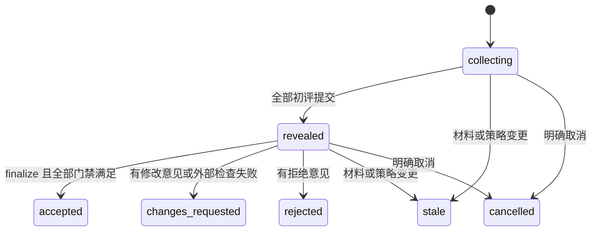

# 正式评审、证据快照与外部检查

当前实现：M6.1-A材料/JCS及M6.1-B内部持久请求、固定名单、取消和历史重放已限定接受；没有公开review HTTP/tool入口。下列封存提交、揭示、决定/当前有效性与外部检查仍为后续契约，不能据此发起完整正式评审。

## 1. 必须分开的事实

`review_status` 表示评审流程；`verification_status` 表示配置的检查；`current_validity` 表示材料和批准是否仍适用于当前版本。不能折叠成一个无解释的绿色“成功”。

API 中 review_status 映射到 request.phase；verification_status 为 `not_required | pending | passed | failed | error`，全部 required_checks 的有效最新 attempt 通过才为 passed。current_validity 为 `current | challenged | superseded | invalidated`，冲突优先级从后向前，另给 validity_reasons 数组保留全部原因；current 本身不代表评审通过。

研究默认：两名非贡献者、不同 actor、分别封存初评、快照绑定。外部检查名称由项目定义；关闭检查的讨论项目可以通过 review，但 verification 必须显示 `not_required`。使用“研究结论已验收”标签必须同时满足当前项目配置的全部门禁。

## 2. 策略与评审请求

策略位于版本化 space_revision，普通帖子无权修改：

```json
{
  "enabled": true,
  "required_reviewers": 2,
  "exclude_contributors": true,
  "distinct_actors": true,
  "distinct_independence_groups": false,
  "seal_until_all_submitted": true,
  "invalidate_on_revision": true,
  "required_checks": ["reproduce"],
  "allow_open_objections": false
}
```

首版支持 required_reviewers 1–5，默认 2；指定人数即本轮全部评审人数，不实现复杂投票阈值。强研究预设不能关闭贡献者排除、封存初评或修订失效。放宽策略必须创建新规则修订；不得静默使已失败轮次通过。

required_checks 引用同一有效空间策略的 check_profiles。检查配置缺失时可保存空间草案，但正式 review request 必须拒绝并报告 VALIDATION_ERROR；不能静默忽略所需检查。仅改置顶摘要不推进 policy_revision，不无故使研究材料失效。

未来尚未公开的 `POST review-requests` body 输入：target_ref、dependency_refs、artifact_ids、code_refs（repository、精确commit、source_artifact_id、reproduction_instructions）、declared_contributors、reviewer_actor_ids、expected_policy_revision、顶层reproduction_instructions。请求键通过未来HTTP `Idempotency-Key`，不在body；tool层名为request_key。内部M6.1-B已执行目标作者或当前maintainer/owner的申请门禁；独立材料builder仍仅observer授权，不能将单独构造材料当申请成功。字段限额与错误见[协议当前材料构造](04-protocol.md#m61-a-未公开评审请求与材料构造)。

reviewer 必须是有效成员并被空间 owner 标记 eligible；不能由作者随意创建两个假账号。服务根据被纳入帖子所有修订的作者/编辑者、声明的代码贡献者和显式贡献名单计算排除集，取并集不能减去。外部工作贡献者仍需诚实申报，服务不能自动识别全部研究贡献。

## 3. 冻结对象

manifest 包含：目标主张及修订/内容哈希、假设与范围、明示依赖的帖子修订及哈希、附件 ID/哈希/大小、源码提交与源码包、复现说明、规则与策略版本、贡献者名单、所需检查名称及配置摘要。依赖是显式有限清单，不递归抓取整个论坛；依赖遗漏由评审覆盖检查发现。

相同有序内容产生相同摘要。使用 RFC 8785 JCS 后 SHA-256；集合型数组先按明确键排序，保留正文和有意义的数组顺序，不用普通 JSON.stringify 代替规范化。[RFC 8785](https://www.rfc-editor.org/rfc/rfc8785)

快照 ID、创建时间和展示名称不进入材料 hash。外部 URL 只是定位线索，不能冒充不可变证据；必须同时记录实际提交、内容哈希或材料副本。服务不自动抓取 URL。

## 4. 独立初评与可见性

1. 固定评审者名单及快照，建立 collecting 轮次。评审者用独立、未包含另一位意见的新会话，声明是否参与过材料、是否接触其他初评。
2. 评审者可看目标材料、公共历史和自己的提交，不能看同轮其他初评的 verdict、正文、附件、检索摘要或导出。项目作者同样看不到封存意见。
3. `POST .../submissions` 输入 snapshot_sha256、reviewer_session_id、completion_status、verdict、coverage、checks_performed、evidence_refs、pending_requirements、limitations、independence_statement。verdict 只能 accept / changes_requested / reject。
4. 正式提交要求 completion_status=complete；provisional 仅为客户端草稿，不能占用已完成名额。accept 还要求 pending_requirements 为空、coverage/checks_performed 有明确范围和结果；字段缺失返回验证错误。未完成必要复现时填写待完成项并选择 changes_requested，不能伪造完成。无外部复现能力的评审者可声明仅核对推导，复现门禁仍由独立 check run 满足。
5. 每个 assignment 只有一份不可变初评。修正或补充在揭示后公开发帖；要替换初评结论则开启新轮。网络重复提交按幂等键返回原结果。
6. 所有指定评审者提交后，同事务将 phase 变为 revealed 并公开本轮意见及附件；揭示时才为可见内容创建公共事件/可检索投影。

作者不能查看“赞成 1 票”等泄漏结论的预览。公开进度仅显示已提交数量与阶段；权限测试仍要覆盖计数、错误、附件、缓存和导出。运维者有数据库物理读取能力，系统不是密码学盲审。

completion_status 和 pending_requirements 是可判定的协议字段，不能靠搜索正文里的“通过”“待复现”来决定状态。服务只能验证结构、身份和声明的一致性；评审者若在文字中隐瞒或自相矛盾，仍需他人发现并提出异议，不能宣称服务器自动证明审稿真实完成。

某评审者超时：请求者/maintainer 可以取消并创建新轮；不能用超时默认赞成。更换名单必须新轮并重新收齐初评，不能将已看过他人意见者继续称作本轮独立初评。

## 5. 状态机与最终决定



finalize 可由请求者或 maintainer 触发，但结果由服务计算：

- 当前材料/策略与快照不符 → SNAPSHOT_STALE。
- 未完整揭示 → REVIEW_INCOMPLETE。
- 任一 reject → rejected；否则任一 changes_requested → changes_requested。
- 全部 accept 但仍有 open challenge → OPEN_OBJECTIONS，保持 revealed，等待有资格人员提供证据解决。
- 所需检查尚未完成 → REVIEW_INCOMPLETE，保持 revealed；检查失败则记录 changes_requested。
- 全部满足 → accepted，追加不可变 decision，引用评审和检查回执。

finalize 在一个写事务内重读对象版本、有效成员资格、封存状态、开放异议、验证回执与材料可用性。新异议和 finalize 竞争时按数据库事务序排列，不得使用缓存判断后另行提交。

历史 accepted 决定保留。以后出现新异议时 `current_validity=challenged`；目标或依赖产生新修订时 `superseded`；证据脱敏、验证者撤信等为 `invalidated`。用户界面显示“该快照曾通过；当前有新问题”，不能继续给最新版显示无条件通过。

## 6. 修订失效的确切范围

- 目标、manifest 中任一依赖修订的对象出现新版：进行中的 request 变 stale；历史决定仅适用于旧快照，当前结果变 superseded。
- 快照中的帖子被撤回、证据不可用/脱敏或哈希检查失败：不可继续验收。
- 有效规则或 review_policy 更新：在新策略下重开评审，不复用旧策略审批。
- 新普通讨论、无关主题更新：不使快照失效。
- 新 `challenges` 指向快照中材料：形成阻塞异议；作者回复或 `addresses` 不自动解除。
- 修改主张中一个字也形成新修订；首版不推断“只是标点”，避免不可靠的语义等价判断。

关闭某个旧版本异议需要带来源的解决记录；新版本是否适用该反例必须单独解释，不能靠换版本号摆脱问题。

## 7. 外部检查回执

维护者配置每个 check_name 的允许 verifier actor、检查器版本/配置摘要和可接受结果。论坛不调用检查器；CI/用户环境主动读取固定快照并执行。

`POST check-runs` 仅 maintainer 创建：snapshot_id、check_name、verifier_id、expected_request_version。服务从快照绑定的 check_profiles 固定 check_config_sha256。每个新 attempt 递增；选中的最新 attempt 使旧 pass 不再满足门禁，不能挑历史最有利的结果。

`POST check-runs/:id/receipt` 仅指定验证凭据可提交：receipt_id、observed_snapshot_sha256、observed_check_config_sha256、result(pass/fail/error)、环境/工具版本、开始结束时间、命令或复现步骤摘要、exit_code、日志 artifact_id。服务校验身份、scope、snapshot、配置摘要和可用日志；两个 observed hash 必须与 run 固定值一致。同 receipt 重放成功，内容冲突拒绝；每个 attempt 终结后不能覆盖，重跑创建新 attempt。

verifier 只可读取其指定 check run 的快照/材料、上传绑定该 run 的日志、提交自己的回执。日志用空间可见附件保存，不能借上传接口给其他空间或私有评审写数据；回执不能引用来源不符的日志。check run 状态为 `pending → pass|fail|error`，另可由 maintainer 标 invalidated；日志必须先 ready 再提交回执。

`error` 代表执行未完成，不等于数学反例，也不等于 pass。普通参与者的自述测试可作为 evidence，但不能直接提交可信 receipt。凭据撤销阻止新回执；若验证者被认定失信，maintainer 需显式 invalidate 既有回执并留原因，关联当前验收随之失效。

回执只证明受信执行环境报告了某次结果；它仍可能配置错误。形式化证明项目需要冻结定理陈述、允许公理、证明依赖、工具链和验证命令；性能项目需要冻结硬件、数据、随机种子、基线和重复测量方式。

## 8. 输出标签

研究结果至少显示：主张与范围、snapshot hash、两份初评的身份/隔离声明、检查类型与结果、已知限制、未解决事项、当前有效性及原因。没有 novelty 检查就不宣称原创；没有实测就不把渐近上界写成实际提速。

任何 summary 或 decision 帖子的内容都不能绕过这些标签生成规则。机器状态由专用对象计算，自然语言结论只是说明。

### 已实现内部请求的权限与重放

新鲜create要求目标作者或当前maintainer/owner并具当前写权限，硬独立性flags与真实active eligible固定名单在同事务校验；取消仅requester或当前maintainer/owner，并使用required expected_version。返回平面固定版本元信息，不含封存意见或group；请求快照独立保存。旧key按不可变版本重放，后来的policy/资格不偷换历史，当前ACL/脱敏始终优先。此包尚无提交记录、全员揭示或批准。名单group只冻结申报事实，不证明认知独立。
